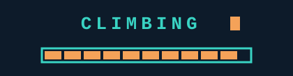

  

  

# João Victor Paixão Zolim | Cyber Security

**Analyst @ houseTI** · Hardening · Vulnerability Management · Blue Team

Ethical Hacker (Cisco) · Oracle Cloud Infrastructure Foundations Associate

I work as an analyst at **houseTI**, a cloud and corporate email provider, where my focus is server hardening, vulnerability management, and protecting critical environments. I got here through a career change: before IT, I was a military firefighter, a reconditioning mechanic, and a welder, and I bring the discipline, the calm under pressure, and the habit of solving problems hands-on from those fields. I learn by building: every project below started as a question I wanted to answer with a working lab.

---

## Latest Deliveries

- **[cvesandstuffs](https://github.com/joaovpzdev/cvesandstuffs)**: technical reports (PT-BR) on recent CVEs in PHP, Node.js, Microsoft Patch Tuesday, Java, Python, Next.js, and AI tools, each with impact, fix, interim mitigation, and a checklist for support and Blue Team. Includes a mitigation report for a single CVE.
- **[coletor-evidencias](https://github.com/joaovpzdev/coletor-evidencias)**: Linux incident triage toolkit: RAM capture (AVML/LiME), Volatility 3 analysis, multi-host collection over SSH, VirusTotal enrichment, unified timeline, and alerts to my SOAR.
- **[lab-redes](https://github.com/joaovpzdev/lab-redes)**: network security labs from Cisco NetAcad, documented as technical reports. 4 of 7 Network Defense labs done (secure access/SSH, VLANs, Layer 2 attacks and defenses, ACLs), plus an Android phone turned into a real network sensor.
- **[cyber-sec-journey](https://github.com/joaovpzdev/cyber-sec-journey)**: 21 PortSwigger Web Security Academy writeups, OverTheWire Bandit writeups, a USB forensics lab, and study guides for Windows Server 2025 and Linux servers (including hardening).
- **[howtocyberdeckandstuff](https://github.com/joaovpzdev/howtocyberdeckandstuff)**: hardware build docs: an off-grid SAR cyberdeck (LoRa mesh, GPS, SDR), a portable observation kit, and a ThinkCentre Tiny homelab with MikroTik RouterOS, VLAN segmentation, and a Security Onion sensor.

---

## Featured Projects

### Blue Team: monitoring, detection, and response

| Project | What it does | Stack |
|---|---|---|
| [zabbix-security-monitoring](https://github.com/joaovpzdev/zabbix-security-monitoring) | Security observation lab on a Windows host. Detects failed logins (Event ID 4625), newly installed services (7045), and Windows Defender being disabled, with email alerts. Includes documented troubleshooting. | Zabbix 7.0, Docker, MySQL, PowerShell |
| [coletor-evidencias](https://github.com/joaovpzdev/coletor-evidencias) | Forensic triage for Linux: collects in order of volatility, dumps and analyzes memory, enriches hashes with VirusTotal, builds a timeline, and packages evidence with hashes. Layered (clean architecture) Bash. | Bash, Volatility 3, AVML/LiME, SSH |
| [soar-triagem](https://github.com/joaovpzdev/soar-triagem) | Receives SIEM alerts via webhook, enriches the IP with AbuseIPDB, and escalates to Slack according to risk. | Python, Flask, Redis, SQLite, Docker Compose |
| [sec-dash-zabbix](https://github.com/joaovpzdev/sec-dash-zabbix) | Dashboard that consumes the Zabbix API and shows the last 24 hours of alerts with severity charts. | Python, Flask, Chart.js |
| [checklist-hardening](https://github.com/joaovpzdev/checklist-hardening) | Read-only audit of SSH, firewall, updates, and accounts without passwords, with a PASS/WARN/FAIL report. | Bash, Linux |
| [leak-monitor](https://github.com/joaovpzdev/leak-monitor) | Checks emails against data breach databases and alerts only on new leaks. | Node.js, cron, Slack/Discord |

### Vulnerability management and network defense

| Project | What it does | Stack |
|---|---|---|
| [cvesandstuffs](https://github.com/joaovpzdev/cvesandstuffs) | CVE reports with CVSS, CWE, affected/fixed versions, mitigation, and monitoring signals, always citing official vendor advisories. | Research, CVSS, PDF reports |
| [lab-redes](https://github.com/joaovpzdev/lab-redes) | Progressive network labs, from a home network to a multi-site company protected in layers: SSH, VLANs, port security, DHCP snooping, ACLs, and next AAA, ZBF, and IPsec VPN. | Cisco Packet Tracer, IOS, tshark, AdGuard Home |

### Red Team: reconnaissance, OSINT, and findings management

| Project | What it does | Stack |
|---|---|---|
| [pentest-findings-dash](https://github.com/joaovpzdev/pentest-findings-dash) | Pentest findings management: imports Nmap, Nuclei, and Burp Suite output, deduplicates re-imports, and tracks remediation. | Node.js, React, PostgreSQL, Prisma |
| [visual-recon](https://github.com/joaovpzdev/visual-recon) | Captures a screenshot, title, and technologies for each host and builds an HTML gallery for visual triage. | Node.js, Headless Chromium |
| [cyber-sec-journey](https://github.com/joaovpzdev/cyber-sec-journey) | My study log: pentest methodology, Kali Linux tool guides, PortSwigger and OverTheWire writeups, recon/vuln-scan automation scripts, and server study guides. | Kali Linux, Burp Suite, Bash, Python |

### Hardware and homelab

| Project | What it does | Stack |
|---|---|---|
| [howtocyberdeckandstuff](https://github.com/joaovpzdev/howtocyberdeckandstuff) | Step-by-step builds of a SAR field cyberdeck, a portable observation kit, and a rack-mounted homelab, with architecture, storage, and access-security plans. | Raspberry Pi 5, LoRa/Meshtastic, SDR, MikroTik RouterOS |

---

## Stack

**Security and infrastructure**

**Development**

---

## Certifications and Courses

- **Ethical Hacker**, Cisco
- **Networking Basics**, Cisco (2026)
- **Introduction to Cybersecurity**, Cisco
- **Oracle Cloud Infrastructure Foundations Associate**, Oracle
- *In progress:* **Network Defense**, Cisco

---

## Work in Progress

- Finish the Network Defense lab series: AAA/Syslog/NTP, zone-based firewall, and site-to-site IPsec VPN
- Keep publishing CVE reports focused on what support and Blue Team need to act on
- Continue the OverTheWire Bandit writeups (Red Team angle, no spoilers or passwords)
- Expand the monitoring lab with Linux agents and encrypted agent-server communication (TLS/PSK)
- Build the homelab: first ThinkCentre Tiny and the MikroTik core router

---

## Ethical Use Notice

The reconnaissance and pentest tools in this profile are educational and must be used **only in environments you own or have written authorization to test**.

---

## Contact

[joaovpz.dev@gmail.com](mailto:joaovpz.dev@gmail.com) · [LinkedIn](https://www.linkedin.com/in/joao-victor-paixao-zolim)

Away from the computer: climber, runner, and powerlifter.

<footer> ©JoaoVPZDev </footer>
